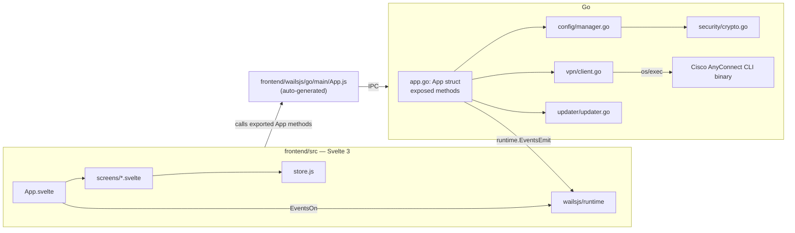

# AGENTS.md — SimpleAC Context Map

Purpose: give an AI coding agent everything needed to work in this repo without re-exploring it from scratch. Read this first. Only open source files when you need exact implementation details or line-level edits.

## 1. What this project is

SimpleAC = desktop GUI wrapper (Wails v2, Go backend + Svelte frontend) around the **Cisco AnyConnect CLI** (`vpn` / `vpncli.exe`). It does not reimplement VPN protocols — it shells out to the official Cisco CLI binary and parses its stdout. Core value-add: encrypted credential storage (AES-256-GCM), one-click connect/disconnect, TOTP (2FA) auto-fill, connection timer, log viewer, self-update check via GitHub Releases.

Single-window app, fixed size 450x600, no resize (see `main.go`).

## 2. Tech stack & pinned versions

| Layer | Tech | Version | Where declared |
|---|---|---|---|
| Backend language | Go | 1.27.0 | [go.mod](go.mod); CI in [.github/workflows/build.yml](.github/workflows/build.yml) |
| Desktop framework | Wails | **v2.16.0** (not v3!) | [go.mod](go.mod) `github.com/wailsapp/wails/v2` |
| Crypto | `golang.org/x/crypto` | v0.57.0 (pbkdf2) | [go.mod](go.mod) |
| TOTP | `github.com/pquerna/otp` | v1.5.0 | [go.mod](go.mod) |
| Frontend framework | Svelte | ^3.49.0, resolves to 3.59.2 (Svelte 3, NOT 4/5) | [frontend/package.json](frontend/package.json) |
| Bundler | Vite | ^3.0.7, resolves to 3.2.11 | [frontend/package.json](frontend/package.json) |
| Svelte/Vite plugin | `@sveltejs/vite-plugin-svelte` | ^1.0.1, resolves to 1.4.0 | [frontend/package.json](frontend/package.json) |
| Node (CI) | 24 | — | [.github/workflows/build.yml](.github/workflows/build.yml); local dev machine default is v24.21.0 via nvm |
| Module path | `github.com/fadinflame/simple-ac` | — | [go.mod](go.mod) |

No TypeScript, no state-management library (plain Svelte stores), no CSS framework (hand-written CSS: design tokens as CSS custom properties in `frontend/src/styles/tokens.css`, `ac-*` component classes in `frontend/src/styles/app.css`, thin Svelte wrappers in `frontend/src/lib/ui/`).

## 3. High-level architecture

**Golden rule of this codebase:** every method on the `App` struct in [app.go](app.go) that should be callable from the UI must (a) be exported (capitalized) and (b) exist in the generated bindings at [frontend/wailsjs/go/main/App.d.ts](frontend/wailsjs/go/main/App.d.ts) / `.js`. Those bindings are regenerated by the Wails CLI (`wails build` / `wails dev` / `wails generate module`) — **do not hand-edit them**, but they ARE committed to git (not gitignored), so after adding/changing an `App` method you must regenerate and commit the updated files in `frontend/wailsjs/`.

## 4. Directory map

| Path | Responsibility |
|---|---|
| [main.go](main.go) | Wails app bootstrap: window options (450x600 fixed), embeds `frontend/dist`, binds `App` struct, `Version` var (set via `-ldflags -X main.Version=x.y.z` in CI, default `"dev"`). |
| [app.go](app.go) | **The entire backend API surface exposed to the frontend.** Thin orchestration layer: owns `ConfigManager` + `VPNClient`, wires Go→JS events (`vpn-log`, `app-log`, `connection-processing`). No business logic lives here beyond wiring. Includes `GetCredentials()` (returns the live in-memory creds for pre-filling the edit form) and `UpdateCredentials(creds, masterPassword)` (re-encrypts to the existing `CredentialsFilePath`, verifying `masterPassword` by decrypting the current file first). |
| [config/config.go](config/config.go) | `Config` struct = non-secret app settings (`credentials_file_path`, optional `cli_path` override for the Cisco CLI; empty = OS default). Plain JSON, unencrypted. |
| [config/credentials.go](config/credentials.go) | `Credentials` struct = secrets (`server`, `username`, `password`, `group` int, `otp_secret`). This is what gets encrypted. |
| [config/manager.go](config/manager.go) | Persistence layer. `Config` → `~/.simple-ac/config.json` (macOS/Linux) or `%APPDATA%/simple-ac/config.json` (Windows), plaintext, mode 0600. `Credentials` → user-chosen path, AES-encrypted blob via `security` package. |
| [security/crypto.go](security/crypto.go) | `Encrypt`/`Decrypt`: AES-256-GCM, key = PBKDF2-SHA256(password, salt, **100000** iterations, 32 bytes). Blob layout: `[16-byte salt][12-byte GCM nonce][ciphertext]`. |
| [vpn/client.go](vpn/client.go) | Wraps the Cisco CLI via `os/exec`. See §6 for details. |
| [updater/updater.go](updater/updater.go) | Hits `GET https://api.github.com/repos/fadinflame/simple-ac/releases/latest`, compares `tag_name` (strip `v` prefix) against `Version`, returns `*Release` if newer, else `nil`. No semver comparison — pure string inequality. |
| [frontend/src/App.svelte](frontend/src/App.svelte) | Root component. Screen router (`{#key $currentScreen}` + `<svelte:component>`), global event listeners, startup sequence (load logs/version, decide Setup vs Password screen), disables context menu. |
| [frontend/src/store.js](frontend/src/store.js) | All shared Svelte writable stores + `navigate()`, `checkConnectionStatus()`, connection timer helpers, `refreshConfig()`. **Single source of truth for cross-screen state.** |
| [frontend/src/constants.js](frontend/src/constants.js) | `AppState` enum: `SETUP, PASSWORD, MAIN, LOGS, SETTINGS, EDIT_CREDENTIALS`. |
| [frontend/src/screens/Setup.svelte](frontend/src/screens/Setup.svelte) | 2-step wizard: (1) VPN credentials (server/username/password/group/OTP secret), (2) choose encrypted config file path + master password → calls `SaveConfig`. |
| [frontend/src/screens/Password.svelte](frontend/src/screens/Password.svelte) | Master-password unlock screen shown on every launch if config exists. Calls `Unlock(password)`. |
| [frontend/src/screens/Main.svelte](frontend/src/screens/Main.svelte) | Connect/disconnect button, connection timer display, navigation to Logs/Settings. |
| [frontend/src/screens/Settings.svelte](frontend/src/screens/Settings.svelte) | Theme toggle, update check (`CheckForUpdates`), "Account" section with an "Edit" button navigating to `AppState.EDIT_CREDENTIALS`, "reset" button. **Note:** reset only navigates to `AppState.SETUP`; it does NOT delete the existing encrypted credentials file or `config.json` — re-running setup will overwrite them if the same path is chosen. |
| [frontend/src/screens/EditCredentials.svelte](frontend/src/screens/EditCredentials.svelte) | Edit VPN credentials in place (reached from Settings). On mount, loads current creds via `GetCredentials()` to pre-fill the form. Password/OTP secret inputs are masked (`type="password"`) by default with a per-field hover-revealed "eye" button that toggles plaintext visibility client-side (no extra IPC round-trip). Saving requires re-entering the master password and calls `UpdateCredentials(creds, masterPassword)`, always writing back to the original `CredentialsFilePath` (no path picker here). Navigates back to `AppState.SETTINGS` on success or cancel. |
| [frontend/src/screens/Logs.svelte](frontend/src/screens/Logs.svelte) | Tabbed viewer for VPN CLI raw output vs. app-level log messages (both fed by Go events, capped client-side at 200000 chars). |
| [frontend/wailsjs/](frontend/wailsjs/) | **Auto-generated** Wails v2 bindings (`go/main/App.js/.d.ts`, `runtime/runtime.js`). Regenerate via `wails build`/`wails dev` after changing `App` method signatures. Committed to git. |
| [frontend/bindings/](frontend/bindings/) | **Stale/unused leftover**, looks like Wails v3-style bindings for a differently-named module (`fadinflame/easyconnect`). Not imported anywhere in `frontend/src`. Ignore it; don't confuse it with `frontend/wailsjs/` which is the one actually used. |
| [wails.json](wails.json) | Wails project config: app name `SimpleAC`, frontend build commands (`npm install`/`npm run build`/`npm run dev`). |
| [.github/workflows/build.yml](.github/workflows/build.yml) | CI: builds on macOS/Windows/Ubuntu via `wails build -ldflags "-X 'main.Version=...'"`. Version = tag name (on `v*` tag push) or `dev-<short-sha>`. Packages zip/tar, creates GitHub Release on tag push. |
| `.vscode/tasks.json` (workspace tasks) | Local build tasks: **build** (`production,desktop` tags), **build debug** (`production,desktop,debug,dev,bindings` tags), **build dev** (`dev` tag). All use `CGO_CFLAGS`/`CGO_LDFLAGS` with `-mmacosx-version-min=10.13` and link `UniformTypeIdentifiers` framework (macOS-specific). |

## 5. Key runtime flows

**App startup** (`App.svelte` `onMount` + `app.startup` in [app.go](app.go)):
1. Go: `runtime.WindowShow` + `WindowCenter`, `ConfigManager.LoadConfig()`, emits `"Application started"` app-log.
2. JS: fetch `GetVPNLogs()`, `GetAppVersion()`, then `CheckConfig()` → navigate to `PASSWORD` (config exists) or `SETUP` (first run).
3. Subscribes to events: `vpn-log`, `app-log`, `connection-processing`.
4. Starts 1s polling loop calling `checkConnectionStatus()` (cheap cached `IsConnected`), plus an initial forced `checkConnectionStatus(true)` (→ `SyncStatus`, real CLI check).

**Setup → SaveConfig**: frontend collects `Credentials` + master password + file path → `App.SaveConfig(creds, password, path)` → `security.Encrypt` → write file → save `Config.CredentialsFilePath` → `setVPNClient(creds)` (creates a live `vpn.Client`, starts its reconcile loop).

**Unlock**: `App.Unlock(password)` → `ConfigManager.LoadCredentials(password, path)` (decrypt) → on success `setVPNClient(creds)`.

**Connect/Disconnect**: `App.Connect()`/`Disconnect()` → sets `isConnecting` flag (emits `connection-processing` event so UI can disable buttons across screens) → delegates to `vpn.Client`.

**Lock**: `App.Lock()` clears `VPNClient` from memory, disconnects, stops its goroutine — purges secrets from RAM without exiting the app. Caller (`Main.svelte` `lockApp()`) then navigates to `AppState.PASSWORD`; the Go method itself does not push a navigation event.

**Settings → Edit Credentials**: `EditCredentials.svelte` `onMount` → `App.GetCredentials()` (reads from the live `vpn.Client`, requires it to be non-nil, i.e. app must be unlocked) → user edits fields, optionally reveals password/OTP secret via the per-field toggle → `App.UpdateCredentials(creds, masterPassword)` → `ConfigManager.LoadCredentials` (verify password against existing file) → `ConfigManager.SaveCredentials` (re-encrypt, same path as before) → `setVPNClient(&creds)` (swaps the live client, restarting its reconcile loop) → navigate back to `AppState.SETTINGS`.

## 6. `vpn.Client` internals ([vpn/client.go](vpn/client.go))

- CLI paths: defaults `/opt/cisco/anyconnect/bin/vpn` (macOS/Linux), `C:\Program Files (x86)\Cisco\Cisco AnyConnect Secure Mobility Client\vpncli.exe` (Windows), exposed via `vpn.DefaultCLIPath()`. A custom path from `Config.CLIPath` (set in Settings › VPN client via `App.SelectCLIPath`/`SetCLIPath`) overrides it; the client reads it on every command through the `cliPath` callback passed to `NewClient`.
- `Connect()`: pipes stdin `"<group>\n<username>\n<password>\n[<totp_code>\n]y\n"` to `vpn -s connect <server>`. TOTP code generated on-the-fly via `totp.GenerateCode(otpSecret, time.Now())` only if `OTPSecret` is set. Success = stdout contains `">> state: Connected"`.
- `Disconnect()`: runs `vpn disconnect`, success = output contains `">> state: Disconnected"`.
- `IsConnected()`: returns cached bool, no CLI call (cheap, for 1s polling).
- `SyncStatus()`/`updateStatus()`: runs `vpn status`, greps for `">> state: Connected"`, updates cache. Called on a **30s background ticker** (`reconcileLoop`, started in `NewClient`) plus on-demand.
- Timeouts: status 5s, connect 10s, disconnect 5s — via `context.WithTimeout` around `exec.CommandContext`.
- Log buffer: `lastOutput` capped at 256KB (`maxLogSize`), streamed chunk-by-chunk to `OnLog` callback (wired to `runtime.EventsEmit(ctx, "vpn-log", ...)` in `app.go`). Status-check output (`silent=true`) is NOT appended to logs or emitted (avoids spamming the log view every 30s/1s).
- `Stop()` closes `stopReconcile` channel to kill the background goroutine — must be called before discarding a `Client` (done in `setVPNClient` and `Lock`).
- CLI start failures: `executeCommand` turns a failed `cmd.Start()` (missing file, no permission, bad format) into a `*vpn.CLIError` with a user-facing message and writes `[ERROR] …` to the log (non-silent calls only). `Connect`/`Disconnect` pass a `CLIError` through unchanged and replace every other error with a generic "… See Logs for details." via `userError`, so `Main.svelte` can show `err` directly as the subtitle. Background status checks fail silently by design.
- `vpn.VerifyCLI(path)` runs `<path> status` (5s timeout) and requires `">> state:"` in the output; used by `App.SetCLIPath` before saving a custom path. Order of checks there: exists → not a dir → exec bit (non-Windows only) → `VerifyCLI`. A rejected path never overwrites the saved one; an empty path resets to default and skips verification. Messages are capitalised sentences because the UI shows them verbatim.
- The Wails file dialog can only filter by extension (`*.exe` on Windows); there is no "executable" filter on macOS/Linux, hence the post-selection checks above.

## 7. Security model

- Master password never stored — used only to derive an AES key on demand (PBKDF2-SHA256, 100k iterations) each time credentials are saved/loaded.
- Encrypted blob = `salt(16) || nonce(12) || AES-GCM ciphertext`. No versioning/magic header — if the KDF params in `security/crypto.go` ever change, old files become unreadable (breaking change).
- `config.json` (non-secret settings) is plaintext but file-mode 0600, directory 0700.
- Credentials file path is itself stored in plaintext `config.json` (`credentials_file_path`) — the path isn't secret, only the file contents are.

## 8. Frontend state (`store.js`) cheat sheet

| Store | Purpose |
|---|---|
| `currentScreen` | drives the router in `App.svelte`; set via `navigate(AppState.X)` |
| `theme` | `'system'` (default) / `'light'` / `'dark'`, persisted to `localStorage`, sets `data-theme` on `<html>` (none = follow OS via `prefers-color-scheme`) |
| `glass` | `'clear'` (default) / `'tinted'`, persisted to `localStorage`, sets `data-glass` on `<html>`; picks the toolbar material (Settings › Appearance › Toolbar) |
| `isConnected` / `isConnecting` | VPN state; `isConnecting` also mirrors the Go `connection-processing` event so long-running connect/disconnect calls disable UI everywhere |
| `vpnLogs` / `appLogs` | raw strings appended to by `vpn-log`/`app-log` events, capped at 200000 chars client-side |
| `connectionSeconds` + `startGlobalTimer`/`stopGlobalTimer` | connection duration ticker, started/stopped from `checkConnectionStatus` |
| `config` | mirrors Go `Config` struct, refreshed via `refreshConfig()` |
| `appVersion`, `hasCheckedUpdate`, `updateRelease` | update-check UI state |

## 9. Conventions to follow when extending this codebase

- New backend capability → add exported method on `App` in [app.go](app.go), keep it a thin wrapper delegating to `config`/`vpn`/`updater`/`security` packages; don't put business logic directly in `app.go`.
- Guard shared `App` state (`VPNClient`, `isConnecting`) with `a.mu` (RWMutex) exactly like existing methods (`getVPNClient`/`setVPNClient` pattern) — don't access `a.VPNClient` directly from new methods.
- Any Go→UI push notification uses `runtime.EventsEmit(a.ctx, "<event-name>", payload)`; subscribe in `App.svelte` (global) or a screen's `onMount` via `EventsOn`, and always `EventsOff`/unsubscribe in `onDestroy` if added at screen level (existing global listeners in `App.svelte` are intentionally never unsubscribed since it lives for the app's lifetime).
- After changing any `App` method signature, regenerate Wails bindings (`wails build` or `wails dev`) and commit the resulting diff under `frontend/wailsjs/go/main/`.
- Frontend has no router/library — new screens: add to `AppState` in [constants.js](frontend/src/constants.js), add the component to the `screens` map in [App.svelte](frontend/src/App.svelte), navigate via `navigate(AppState.X)` from `store.js`.
- Styling: follows the SimpleAC design system (macOS-native look). Use the components in `frontend/src/lib/ui` (Button, TextField, Group/Row/FieldRow, Toolbar…) and the tokens in `styles/tokens.css` (`--bg-window`, `--label`, `--accent-fill`, `--space-*`…); never hard-code colours. `tokens.css` is generated from the design system's `tokens.json` — change values there. One `variant="default"` button per screen. Design v2 (macOS 27 look): the `Toolbar` is glass and laid over the content — screens pad their content with `var(--chrome-top)`; related toolbar buttons go in a `ToolbarGroup`, a lone one is `ToolbarButton round`. Platform differences (traffic-light inset, hidden app title off macOS, tinted fallback without `backdrop-filter`) live in CSS keyed on `data-platform`, never in per-OS screens.
- Window is fixed-size, non-resizable by design (`main.go` options) — don't add layouts that assume resizing.
- Settings is a scrolling screen in a fixed 600px window; it was tuned to just fit (long group footers were moved into dialogs to avoid a nominal scrollbar). Adding rows/footers there can bring the scrollbar back — check it in `wails dev`.
- UI text uses neutral wording ("VPN client", "VPN command-line client") rather than Cisco/AnyConnect product names (trademark); the README carries the non-affiliation notice. Keep Cisco names to code, paths and docs.
- Transient UI errors (connect failure, rejected CLI path) auto-dismiss after ~8s and are cleared on the next attempt; don't leave stale error text pinned to a control whose value didn't change.

## 10. Testing

- Go tests: `go test -race ./...` covers `vpn`, `config`, `security`, `updater` and the `main` package (`app_test.go`, `app_flow_test.go`). Tests for the `main` package need the macOS CGO flags and tag from the VS Code tasks: `CGO_CFLAGS="-mmacosx-version-min=10.13" CGO_LDFLAGS="-framework UniformTypeIdentifiers -mmacosx-version-min=10.13" go test -tags dev .` (without them linking fails with `_OBJC_CLASS_$_UTType`), and `frontend/dist` must exist (it is embedded; gitignored, produced by `wails build` / `npm run build`).
- Tests fake the Cisco CLI with `#!/bin/sh` scripts in `t.TempDir()` and are skipped on Windows. Never let a test reach the real CLI: App tests point `Config.CLIPath` at a fake before anything starts a `vpn.Client` (see `newUnlockableApp`). Tests isolate config by `t.Setenv("HOME", …)` (`APPDATA` on Windows). The `VerifyCLI` timeout path is untested (`statusTimeout` is a 5s const).
- `updater.latestReleaseURL` is a package var so tests can point it at `httptest`.
- When a fake CLI is shared with the background `status` poll (`reconcileLoop`), answer `status` before recording args/stdin, otherwise the poll overwrites them.
- CI ([.github/workflows/build.yml](.github/workflows/build.yml)) runs `go test -tags desktop,production [-race] ./...` after `wails build` on all three OSes (macOS adds `CGO_LDFLAGS=-framework UniformTypeIdentifiers`; `-race` is off on Windows). Workflow triggers include `develop`.
- No frontend tests exist.
