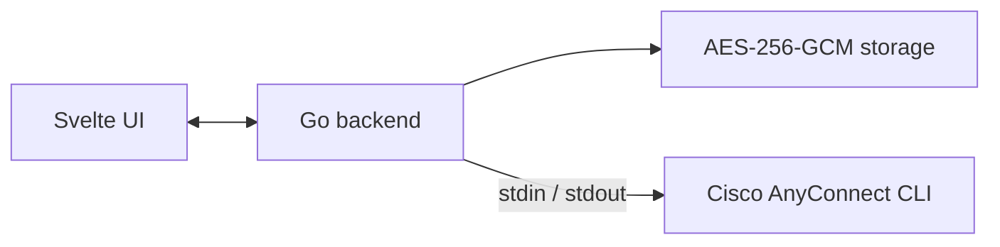

<div align="center">

# SimpleAC

**A calm, native-feeling desktop app for the Cisco AnyConnect CLI.**
One click to connect. Credentials encrypted. TOTP filled in for you.

[](https://github.com/fadinflame/simple-ac/releases/latest)
[](https://github.com/fadinflame/simple-ac/actions)
[](LICENSE)


English · [Русский](README.ru.md)


</div>

---

## Overview

SimpleAC is a lightweight, open-source GUI for the **Cisco AnyConnect command-line client**. It does not implement any VPN protocol itself: it drives the official CLI that is already installed on your machine and presents it in a small, focused window.

Your VPN details are stored in a single file encrypted with a master password, so connecting is as simple as unlocking the app and pressing **Connect**.

## Features

**Connection**
- One-click connect and disconnect, with a live connection timer.
- Automatic status sync: the app notices when the VPN state changes outside of it.
- Clear, human-readable errors when the CLI is missing, not executable, or the connection fails.

**Security**
- AES-256-GCM encryption with a key derived from your master password (PBKDF2-SHA256, 100,000 iterations).
- The master password is never stored. It is used only to derive the key when credentials are loaded or saved.
- **Lock** wipes credentials from memory and disconnects, without quitting the app.
- Secrets are never written to disk in plain text. Only non-sensitive settings are stored unencrypted.

**Two-factor authentication**
- Built-in TOTP generator (Google Authenticator compatible): paste your OTP secret once, and the code is generated and submitted automatically on every connect.

**Everyday comfort**
- Built-in log viewer with separate tabs for raw VPN client output and app events.
- Edit your credentials in place, with password and OTP fields masked until you reveal them.
- Custom CLI location with validation, for non-standard installs.
- Light, dark, or system theme, and a choice of toolbar material.
- Keyboard shortcuts: `Cmd/Ctrl + ,` for Settings, `Cmd/Ctrl + L` to lock.
- Manual update check against GitHub Releases.
- Small footprint compared to the official client.

## Screenshots

<table>
  <tr>
    <td align="center"><br><sub>Unlock with your master password</sub></td>
    <td align="center"><br><sub>Connect with one click</sub></td>
    <td align="center"><br><sub>Settings</sub></td>
  </tr>
  <tr>
    <td align="center"><br><sub>Setup: VPN details</sub></td>
    <td align="center"><br><sub>Setup: encryption</sub></td>
    <td align="center"><br><sub>Live logs</sub></td>
  </tr>
</table>

Full-size images: [SCREENSHOTS.md](SCREENSHOTS.md).

## Requirements

- The **official Cisco AnyConnect client** (with its command-line tool) installed on your system.
- A VPN profile where the login prompts come in the order **group, username, password, (optional) one-time code**. SimpleAC feeds the CLI exactly this sequence.

Default CLI locations:

| OS | Path |
|---|---|
| macOS / Linux | `/opt/cisco/anyconnect/bin/vpn` |
| Windows | `C:\Program Files (x86)\Cisco\Cisco AnyConnect Secure Mobility Client\vpncli.exe` |

Installed somewhere else? Point SimpleAC to it in **Settings › VPN client**. The path is verified before it is saved.

## Installation

### From Releases (recommended)

1. Open the [Releases](https://github.com/fadinflame/simple-ac/releases/latest) page.
2. Download the build for your OS: macOS (`.zip`), Windows (`.zip`), or Linux (`.tar.gz`).
3. Unpack and run.

### Build from source

You need [Go](https://go.dev/), [Node.js](https://nodejs.org/) and the [Wails v2 CLI](https://wails.io/).

```bash
git clone https://github.com/fadinflame/simple-ac.git
cd simple-ac
wails build
```

The binary is placed in `build/bin/`. For live development use `wails dev`.

## Getting started

1. **Launch SimpleAC.** On first run a two-step setup opens.
2. **Enter your VPN details:** server, username, password, group, and optionally the TOTP secret.
3. **Choose where to save the encrypted file** and set a master password.
4. From then on, unlock with the master password and press **Connect**.

## Good to know

- **There is no password recovery.** If you forget the master password, the encrypted file cannot be opened. Set up again and re-enter your VPN details.
- **Back up the credentials file** if it matters to you. Its location is shown during setup; it is a single self-contained file.
- **"Set Up Again" does not delete anything.** Saving to the same path overwrites the old file; a different path leaves the old one on disk.
- **TOTP needs an accurate clock.** If the server rejects codes, check that your system time is synchronized.
- **Timeouts are short by design.** A connection attempt is limited to 10 seconds, so slow servers may need a retry. Details are always in the Logs screen.
- **The window has a fixed size** and is not resizable.
- **Updates are manual.** Use *Check for Updates* in Settings; SimpleAC opens the release page rather than patching itself.
- **Changing the encryption parameters in a future version would make older files unreadable.** Keep this in mind when upgrading across major changes.

## Security model

| Item | Where it lives | Protection |
|---|---|---|
| Server, username, password, group, OTP secret | A file you choose | AES-256-GCM, key from PBKDF2-SHA256 (100k iterations) |
| Master password | Nowhere | Used only to derive the key, never persisted |
| Settings (credentials file path, CLI path) | `~/.simple-ac/config.json` on macOS/Linux, `%APPDATA%\simple-ac\config.json` on Windows | Plain JSON, file mode `0600` |

File layout: `salt (16 bytes) || nonce (12 bytes) || ciphertext`.

## How it works



SimpleAC runs `vpn -s connect <server>` and writes the login answers to its standard input. Connection state is read from the CLI's `status` output and re-checked in the background every 30 seconds.

## Legal

- **Not a modification.** SimpleAC does not modify, patch or interfere with the Cisco AnyConnect binaries or protocols.
- **Wrapper only.** It runs standard commands (`vpn connect`, `vpn disconnect`, `vpn status`) of the official installation.
- **No affiliation.** SimpleAC is not affiliated with, endorsed by, or sponsored by Cisco Systems, Inc. "Cisco" and "AnyConnect" are trademarks of Cisco Systems, Inc.
- **"As is".** The software is provided without warranty of any kind. Use it at your own risk.

## License

Released under the [MIT License](LICENSE).
