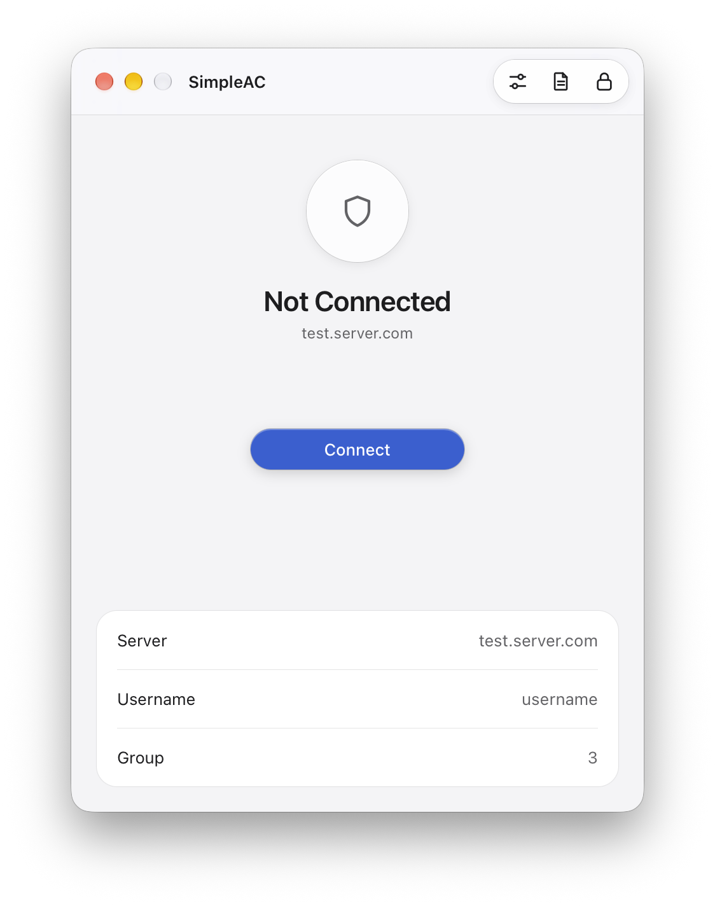
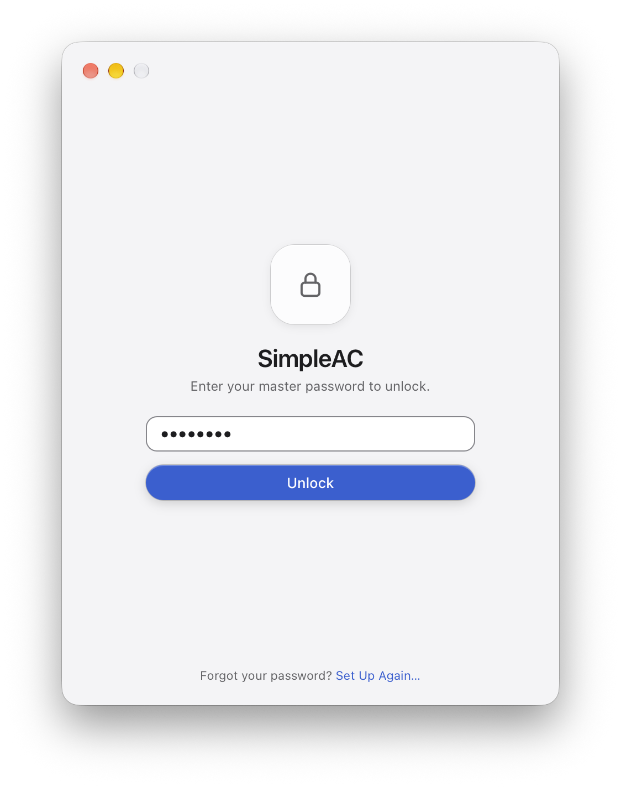
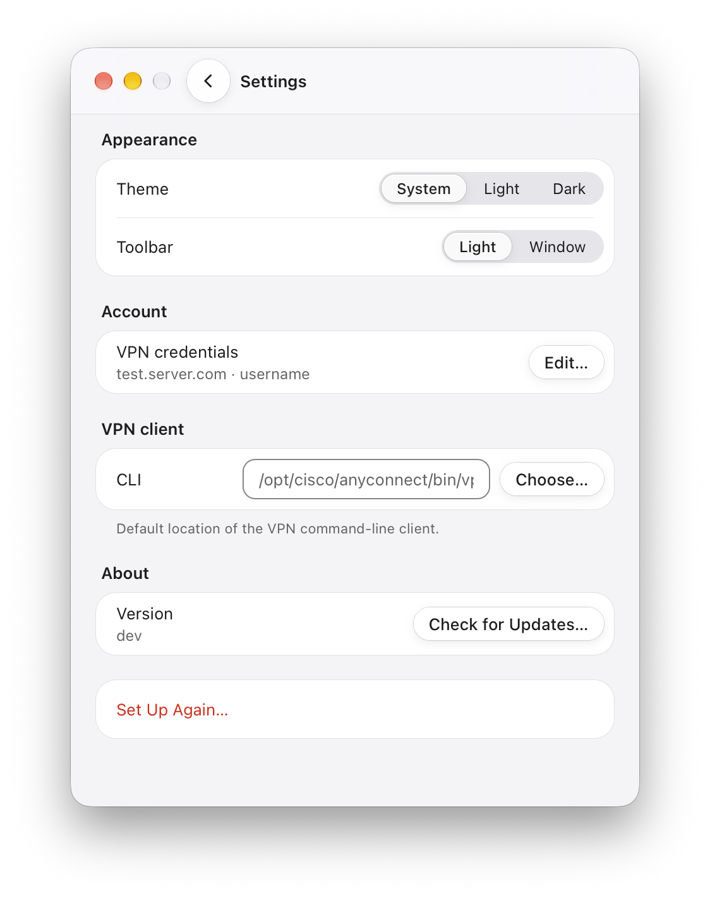
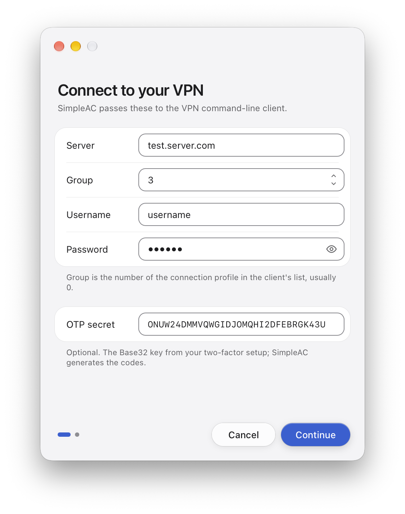
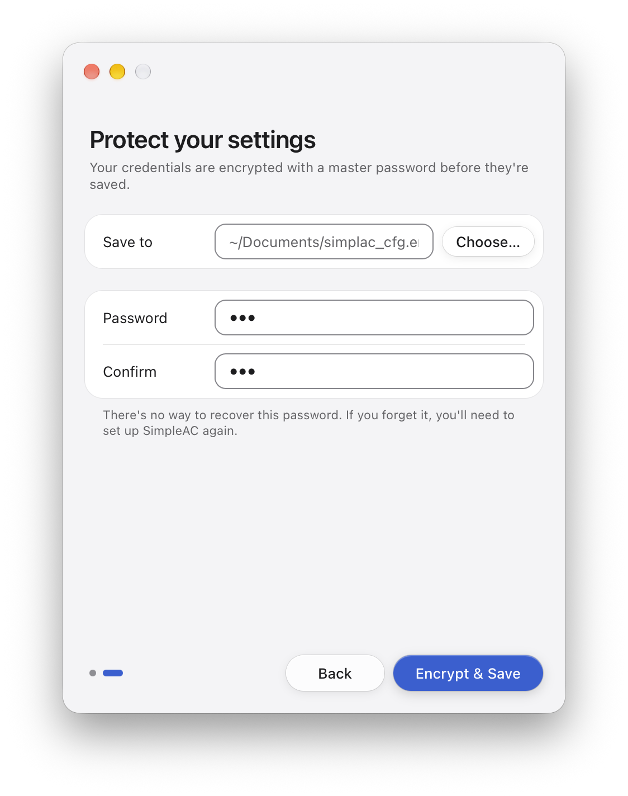
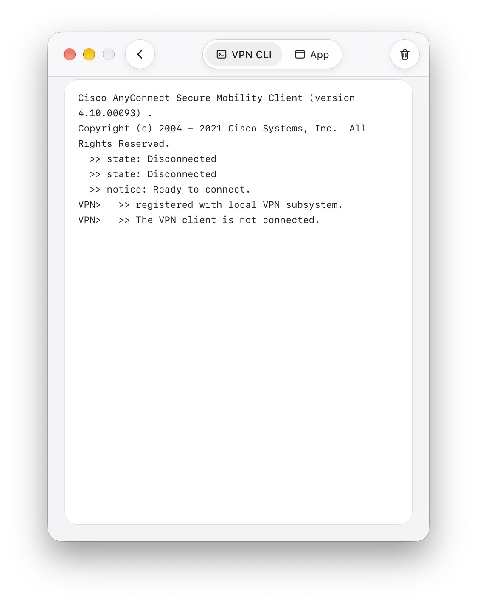
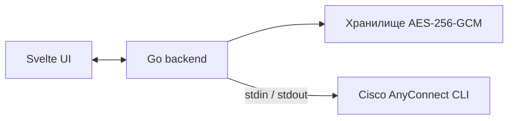

<div align="center">

# SimpleAC

**Спокойное нативное приложение для командной строки Cisco AnyConnect.**
Подключение в один клик. Шифрование учётных данных. TOTP подставляется сам.

[](https://github.com/fadinflame/simple-ac/releases/latest)
[](https://github.com/fadinflame/simple-ac/actions)
[](LICENSE)


[English](README.md) · Русский



</div>

---

## Обзор

SimpleAC — лёгкая графическая оболочка с открытым исходным кодом для **командной строки Cisco AnyConnect**. Приложение не реализует VPN-протоколы само: оно управляет официальным CLI, уже установленным в системе, и показывает его в компактном окне.

Данные для входа хранятся в одном файле, зашифрованном мастер-паролем, поэтому подключение сводится к разблокировке приложения и нажатию **Connect**.

## Возможности

**Подключение**
- Подключение и отключение в один клик, таймер соединения в реальном времени.
- Автоматическая синхронизация статуса: приложение замечает изменения состояния VPN, сделанные вне его.
- Понятные сообщения об ошибках, если CLI не найден, не запускается или подключение не удалось.

**Безопасность**
- Шифрование AES-256-GCM, ключ выводится из мастер-пароля (PBKDF2-SHA256, 100 000 итераций).
- Мастер-пароль нигде не хранится: он нужен только для получения ключа при чтении и записи данных.
- Кнопка **Lock** стирает данные из памяти и отключает VPN, не закрывая приложение.
- Секреты никогда не пишутся на диск в открытом виде. Без шифрования хранятся только несекретные настройки.

**Двухфакторная аутентификация**
- Встроенный генератор TOTP (совместим с Google Authenticator): один раз вставьте OTP-секрет, и код будет генерироваться и подставляться при каждом подключении.

**Удобство каждый день**
- Просмотр логов во встроенном окне: отдельные вкладки для вывода VPN-клиента и событий приложения.
- Редактирование учётных данных на месте; пароль и OTP-секрет скрыты, пока вы их не покажете.
- Собственный путь к CLI с проверкой, для нестандартных установок.
- Светлая, тёмная или системная тема, на выбор материал панели инструментов.
- Горячие клавиши: `Cmd/Ctrl + ,` — настройки, `Cmd/Ctrl + L` — блокировка.
- Ручная проверка обновлений через GitHub Releases.
- Небольшой размер и потребление ресурсов по сравнению с официальным клиентом.

## Скриншоты

<table>
  <tr>
    <td align="center"><br><sub>Разблокировка мастер-паролем</sub></td>
    <td align="center"><br><sub>Подключение в один клик</sub></td>
    <td align="center"><br><sub>Настройки</sub></td>
  </tr>
  <tr>
    <td align="center"><br><sub>Настройка: данные VPN</sub></td>
    <td align="center"><br><sub>Настройка: шифрование</sub></td>
    <td align="center"><br><sub>Логи в реальном времени</sub></td>
  </tr>
</table>

Все скриншоты в полном размере: [SCREENSHOTS.md](SCREENSHOTS.md).

## Требования

- Установленный **официальный клиент Cisco AnyConnect** (вместе с его командной строкой).
- VPN-профиль, в котором запросы идут в порядке **группа, имя пользователя, пароль, (опционально) одноразовый код**. Именно в таком порядке SimpleAC передаёт данные в CLI.

Расположение CLI по умолчанию:

| ОС | Путь |
|---|---|
| macOS / Linux | `/opt/cisco/anyconnect/bin/vpn` |
| Windows | `C:\Program Files (x86)\Cisco\Cisco AnyConnect Secure Mobility Client\vpncli.exe` |

Клиент установлен в другом месте? Укажите путь в **Settings › VPN client**. Перед сохранением путь проверяется.

## Установка

### Из Releases (рекомендуется)

1. Откройте страницу [Releases](https://github.com/fadinflame/simple-ac/releases/latest).
2. Скачайте сборку для своей ОС: macOS (`.zip`), Windows (`.zip`) или Linux (`.tar.gz`).
3. Распакуйте и запустите.

### Сборка из исходного кода

Понадобятся [Go](https://go.dev/), [Node.js](https://nodejs.org/) и [Wails v2 CLI](https://wails.io/).

```bash
git clone https://github.com/fadinflame/simple-ac.git
cd simple-ac
wails build
```

Бинарник появится в `build/bin/`. Для разработки с live-перезагрузкой используйте `wails dev`.

## Быстрый старт

1. **Запустите SimpleAC.** При первом запуске откроется двухшаговая настройка.
2. **Введите данные VPN:** сервер, имя пользователя, пароль, группу и, при необходимости, TOTP-секрет.
3. **Выберите, где сохранить зашифрованный файл**, и задайте мастер-пароль.
4. Дальше достаточно разблокировать приложение мастер-паролем и нажать **Connect**.

## Что стоит знать

- **Восстановления пароля нет.** Если вы забудете мастер-пароль, зашифрованный файл открыть не получится. Настройте приложение заново и введите данные VPN снова.
- **Делайте резервную копию файла с учётными данными**, если он вам важен. Его расположение показывается при настройке; это один самодостаточный файл.
- **«Set Up Again» ничего не удаляет.** При сохранении по тому же пути старый файл перезаписывается; при другом пути старый остаётся на диске.
- **Для TOTP нужны точные часы.** Если сервер отклоняет коды, проверьте синхронизацию системного времени.
- **Таймауты намеренно короткие.** Попытка подключения ограничена 10 секундами, поэтому для медленных серверов может понадобиться повтор. Подробности всегда есть на экране Logs.
- **Размер окна фиксированный**, изменить его нельзя.
- **Обновления проверяются вручную.** Нажмите *Check for Updates* в настройках; SimpleAC откроет страницу релиза, а не обновляет себя сам.
- **Смена параметров шифрования в будущих версиях сделает старые файлы нечитаемыми.** Учитывайте это при обновлении между крупными версиями.

## Модель безопасности

| Что | Где хранится | Защита |
|---|---|---|
| Сервер, логин, пароль, группа, OTP-секрет | Файл, который выбираете вы | AES-256-GCM, ключ из PBKDF2-SHA256 (100k итераций) |
| Мастер-пароль | Нигде | Только для получения ключа, не сохраняется |
| Настройки (путь к файлу данных, путь к CLI) | `~/.simple-ac/config.json` на macOS/Linux, `%APPDATA%\simple-ac\config.json` на Windows | Обычный JSON, права `0600` |

Формат файла: `salt (16 байт) || nonce (12 байт) || ciphertext`.

## Как это работает



SimpleAC запускает `vpn -s connect <server>` и передаёт ответы на запросы входа через стандартный ввод. Состояние соединения считывается из вывода `status` и перепроверяется в фоне каждые 30 секунд.

## Юридическая информация

- **Не модификация.** SimpleAC не изменяет, не патчит и не вмешивается в работу бинарных файлов и протоколов Cisco AnyConnect.
- **Только оболочка.** Приложение вызывает стандартные команды (`vpn connect`, `vpn disconnect`, `vpn status`) официальной установки.
- **Нет аффилиации.** SimpleAC не связан с Cisco Systems, Inc., не одобрен и не спонсируется ею. «Cisco» и «AnyConnect» — торговые марки Cisco Systems, Inc.
- **«Как есть».** Программное обеспечение предоставляется без каких-либо гарантий. Используйте на свой страх и риск.

## Лицензия

Распространяется по [лицензии MIT](LICENSE).
